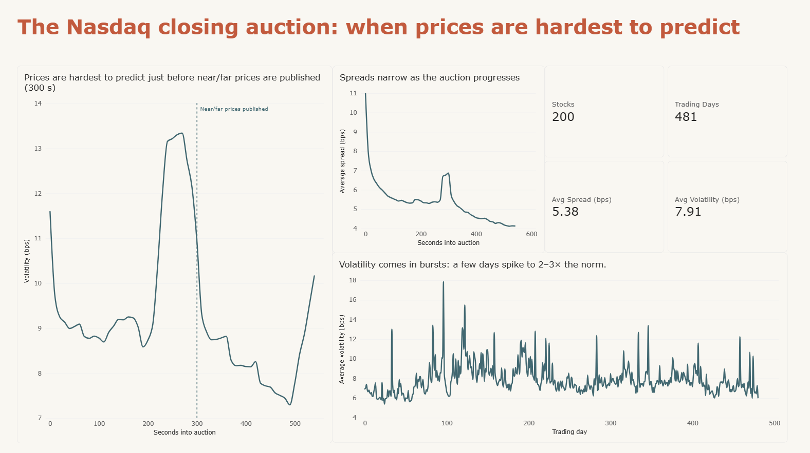
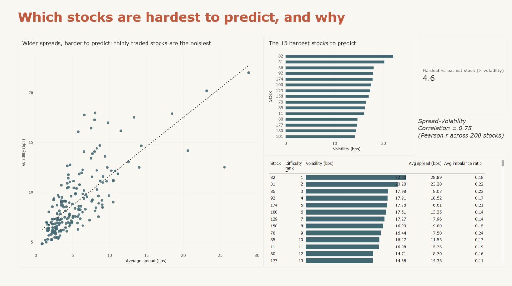
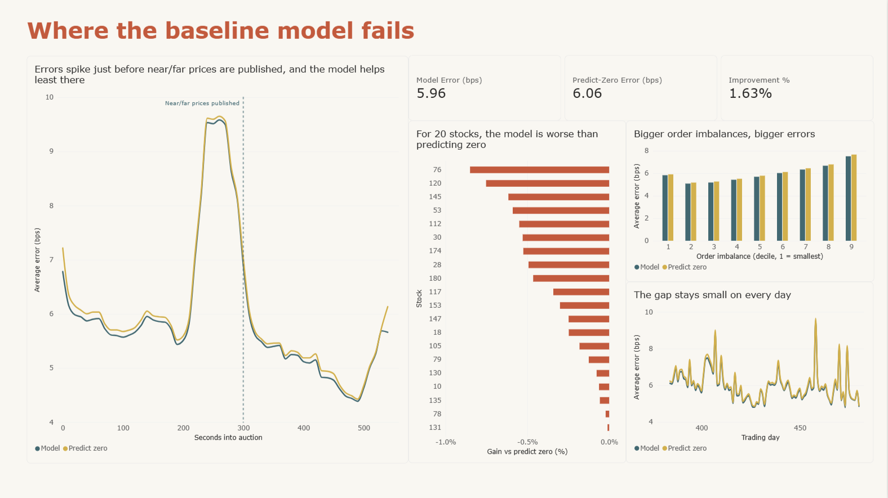
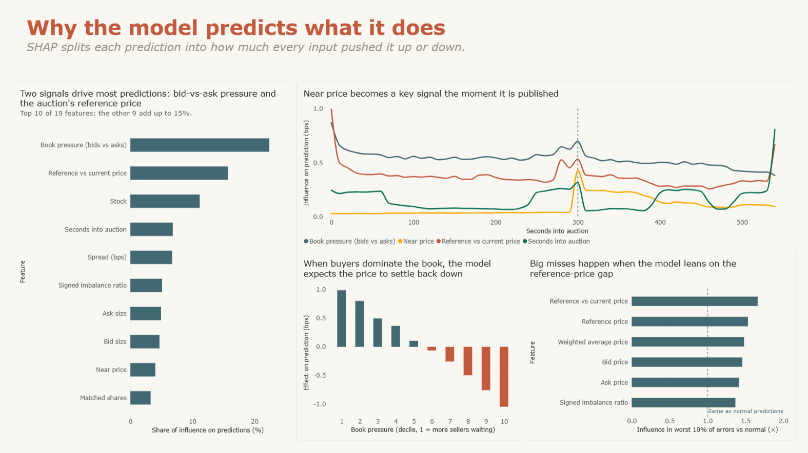
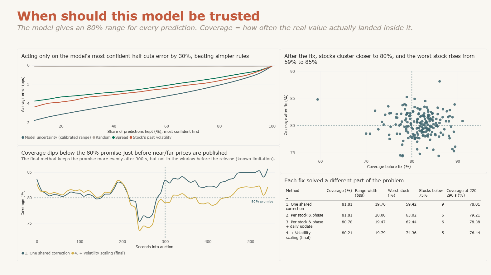

# When are closing-auction prices hardest to predict, and when can a model be trusted?

A Power BI report and a Python analysis of the Optiver "Trading at the Close" Kaggle data, covering
the Nasdaq closing auction for 200 stocks over 481 trading days. It asks four questions. Where are
prices hardest to predict? Where does a baseline model fail? Why does it predict what it does? And
when can its predictions be trusted?

The report is in [`powerbi/closing_auction.pdf`](powerbi/closing_auction.pdf) (no Power BI needed)
and [`powerbi/closing_auction.pbix`](powerbi/closing_auction.pbix).

## Background

Many exchanges end the trading day with a closing auction. Buyers and sellers submit orders, and one
closing price is set where the most shares can trade. In the last ten minutes, Nasdaq publishes
updates: shares already matched, the imbalance left on the buy or sell side, and indicative prices.
Two of these, the near price and the far price, only appear from 300 seconds into the window.

The task, set by Optiver, is to predict each stock's move over the next 60 seconds relative to an
index of all stocks. Moves are measured in basis points (bps), where 1 bp is 0.01%.

## Data

- Optiver "Trading at the Close", Kaggle (Sep 2023 to Mar 2024):
  https://www.kaggle.com/competitions/optiver-trading-at-the-close
- 5,237,892 snapshots, 200 stocks, 481 trading days, one snapshot every 10 seconds of the auction.
- The raw data is not included here. Competition data may not be redistributed, so download
  `train.csv` from Kaggle after accepting the competition rules. This repository holds the code,
  the report (built on aggregated tables) and screenshots.

## Method

1. **Auction overview.** Spread, imbalance and target volatility by stock, day and second.
2. **Baseline model.** LightGBM (gradient-boosted trees) trained to minimise mean absolute error
   (MAE: the average size of a miss, lower is better), the competition's own metric. It is trained
   on days 0-383 and tested on days 384-480, so it never sees the future. Early stopping uses the
   last 10% of training days, which keeps the test days untouched. A "predict zero" guess is the
   reference point any model has to beat.
3. **Error analysis.** Errors broken down by stock, second of the auction, imbalance size and day.
4. **Explainability.** SHAP values from LightGBM's built-in TreeSHAP split each prediction into the
   push from every input. They are computed on 200,000 test rows (seed 42).
5. **Calibrated uncertainty.** Quantile regression gives an 80% range for every prediction.
   Conformal calibration on held-out days adjusts the ranges so they keep that promise. Coverage
   means how often the real value landed inside the range, and 80% is the target.

Most of the error here comes from market noise whose size varies by stock and time (aleatoric
uncertainty). That is why I used quantile ranges with conformal calibration rather than disagreement
between several models. Disagreement mostly measures the model's own uncertainty, which is small for
gradient-boosted trees trained on millions of rows.

## Findings

### 1. Prices are hardest to predict just before new information is released

Volatility peaks at 270 seconds (13.3 bps), just before near and far prices are first published, then
drops sharply. Spreads narrow steadily as the auction goes on.

### 2. Thinly traded stocks are the noisiest

Across 200 stocks, wider spreads go with higher volatility (Pearson r = 0.75). The hardest stock is
4.6 times as volatile as the easiest.

### 3. The baseline beats "predict zero" by only 1.6%

The model's MAE is 5.96 bps against 6.06 for predicting zero. That small gain is the honest picture,
since most of a 60-second move is noise. Errors spike in the same 220-290 second window, and the model
helps least there. For 20 of the 200 stocks it does worse than predicting zero.

### 4. Two signals drive most predictions

Book pressure (bid size against ask size) accounts for 22% of the model's influence. The gap between
the auction's reference price and the current price accounts for 16%.

One result looks counter-intuitive. When buyers dominate the book, the model predicts a small fall.
My best explanation is that the current price already leans towards the sell side, so the move
settles back. Near price barely matters until 300 seconds, then becomes a key signal the moment it is
published.

### 5. Trusting only confident predictions cuts error by 30%

Ranking predictions by the width of their range and acting only on the narrowest half cuts MAE from
5.96 to 4.16 bps. That beats two simpler rules: a stock's past volatility (4.63) and its spread
(4.75).

The first calibration held 81.8% coverage on average, but individual stocks ranged from 59% to 91%.
I traced this to stocks whose volatility jumped after the calibration days. The correlation between
that jump and a stock's coverage was -0.69. Three changes, each tested on its own, fixed different
parts of the problem:

| Method | Coverage | Range width | Worst stock | Stocks below 75% | Coverage at 220-290 s |
|---|---|---|---|---|---|
| 1. One shared correction | 81.8% | 19.76 bps | 59.4% | 9 | 78.0% |
| 2. Per stock and auction phase | 81.8% | 20.00 bps | 63.0% | 6 | 79.2% |
| 3. Method 2 + daily update | 80.8% | 19.47 bps | 62.4% | 6 | 78.4% |
| 4. Method 3 + volatility scaling | 80.2% | 19.79 bps | 74.4% | 5 | 76.4% |

The final method lifted the stock whose volatility rose 2.4 times from 62% to 85% coverage.

## Limitations

- The window just before the 300-second release is still under-covered (76.4%). Calibration cannot
  fix this. The model would need a signal that anticipates the release.
- The risk-coverage result in finding 5 uses the ranges from the first calibration method.
- The test period (days 384-480) was calmer than the training period, so results may not hold in a
  more volatile market.
- The baseline is deliberately simple. Leaderboard solutions were scored on a different, later
  period, so the numbers are not directly comparable.

## How to reproduce

1. Download `train.csv` from the Kaggle competition into `data/raw/`.
2. `pip install -r requirements.txt`
3. `python scripts/prepare_tables.py`
4. `python scripts/train_baseline.py`
5. Inside `scripts/`, run in order: `shap_analysis.py`, `uncertainty_analysis.py`,
   `group_conformal.py`, `vol_conformal.py`, `build_page5_tables.py`.
6. Open `powerbi/closing_auction.pbix` in Power BI Desktop and refresh.

Every script uses a fixed seed (42) and deterministic LightGBM settings. My working notes, including
a correction to an early reading of the data, are in [`notes/INSIGHTS_LOG.md`](notes/INSIGHTS_LOG.md).

## Tools

Python (pandas, NumPy, LightGBM) and Power BI Desktop (Power Query, DAX). The colour theme
(`powerbi/okabe_ito_theme.json`) uses the Okabe-Ito palette, which stays readable with colour-vision
deficiency.

## References

- Romano, Patterson and Candes (2019). Conformalized quantile regression. NeurIPS.
- Gibbs and Candes (2021). Adaptive conformal inference under distribution shift. NeurIPS.
- Vovk, Gammerman and Shafer (2005). Algorithmic Learning in a Random World. Springer.
- Lundberg and Lee (2017). A unified approach to interpreting model predictions. NeurIPS.
